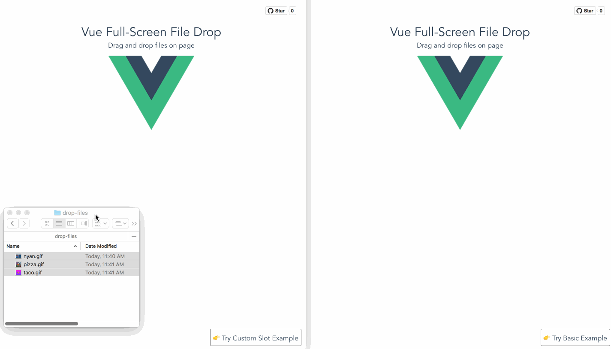

> **⚠️ Archived — July 2026**
>
> This project is no longer maintained and closed for contributions. The ecosystem has evolved significantly since 2017, and modern alternatives provide better UX, TypeScript support, Vue 3 compatibility, validation, previews, and accessibility — all with minimal code.
>
> **Recommended replacements:**
>
> | If you need… | Use |
> |---|---|
> | **Minimal drag-drop + full-screen overlay** | [`useDropZone`](https://vueuse.org/core/usedropzone/) from VueUse — a 1kB composable. Add a `v-show="isOverDropZone"` overlay and you're done. |
> | **Beautiful drop zone with image previews** | [`vue-filepond`](https://github.com/pqina/vue-filepond) — polished UX, plugins for validation/resize/exif, Vue 3 native. |
> | **Production uploads (progress, retries, S3, cloud sources)** | [Uppy](https://uppy.io/docs/vue/) — resumable uploads, dashboard UI, Drive/Dropbox integration, full Vue 3 support. |
> | **Validation + composition API convenience** | [`vue3-dropzone`](https://www.npmjs.com/package/vue3-dropzone) — react-dropzone inspired: accept, max/min size, maxFiles, `isDragActive` state. |
> | **Part of a UI kit** | [PrimeVue FileUpload](https://primevue.org/fileupload/), [Element Plus el-upload](https://element-plus.org/en-US/component/upload.html), or [Naive UI n-upload](https://www.naiveui.com/en-US/os-theme/components/upload) — all Vue 3 + TypeScript, drag support, validation, and previews built in. |
>
> For a quick modern equivalent of this library's behavior:
>
> ```vue
> <script setup lang="ts">
> import { useDropZone } from '@vueuse/core'
>
> const { isOverDropZone } = useDropZone(document, {
>   onDrop(files) {
>     if (!files?.length) return
>     const fd = new FormData()
>     files.forEach(f => fd.append('upload', f))
>     // emit or post fd
>   },
> })
> </script>
>
> <template>
>   <div v-show="isOverDropZone" class="fixed inset-0 z-50 bg-black/40 flex items-center justify-center text-white text-4xl">
>     Drop files here
>   </div>
>   <!-- rest of app -->
> </template>
> ```

# Vue Full Screen File Drop

> a Vue.js file drop component. Minimal API: you decide what happens after files are dropped.

## Background



## Install

```bash
npm install --save vue-full-screen-file-drop
```

## Usage

### Basic Usage

```javascript
import VueFullScreenFileDrop from 'vue-full-screen-file-drop';
import 'vue-full-screen-file-drop/dist/vue-full-screen-file-drop.css';
```

Then in your template:

```html
<VueFullScreenFileDrop @drop='onDrop'>
```

The `@drop` event has is passed two args.

* `formData` - a [`FormData`](https://developer.mozilla.org/en-US/docs/Web/API/FormData) object that can be used directly to post to server as multipart form. The default field for form is `upload` by default. This can be changed via a prop.
* `files` - a [`FileList`](https://developer.mozilla.org/en-US/docs/Web/API/FileList) object that is part of the [`DataTransfer`](https://developer.mozilla.org/en-US/docs/Web/API/DataTransfer/files) api. Note this is array-like, so may not respond to to typical array methods directly.

```javascript
// Example event handler
onDrop(formData, files) {
  console.log(formData); // Can be posted to server
  console.log(files);    // Can get access to things like file name and size
}
```

### Component Props

| Name          | Type   | Default     | Description                                        |
|---------------|--------|-------------|----------------------------------------------------|
| formFieldName | String | upload      | Form field containing files in the FormData object |
| text          | String | Upload File | Text shown in the drop zone area                   |

### Style Overrides

You can override the styles, see [the css definitions here](dist/vue-full-screen-file-drop.css)

### Custom Slot

If you want to completely define your own drop zone area, this is supported via a slot. You can see an [example here](demo/src/ExampleCustomSlot.vue)

```html
<VueFullScreenFileDrop>
  <div>Some custom content</div>
</VueFullScreenFileDrop>
```

## Development

```bash
# Build main library

npm install
npm run build

# Run demo site in development mode
# Changes picked up from src/VueFullScreenDrop.vue

cd demo
npm install
npm run dev

# Build production demo site
# (build main library first if you want to see updates)

npm install
npm run demo:build

# Testing
npm run test

# Auto watch tests
npm run test:watch
```
